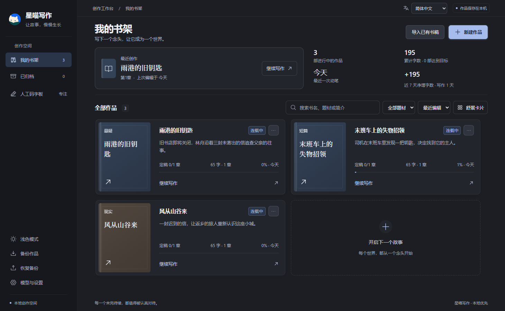

**English** | [简体中文](README.zh-CN.md)

<p align="center">
  
</p>

<h1 align="center">Xingmiao Writer · Open Core</h1>

<p align="center"><strong>A local-first fiction workspace for manual writing, AI drafting, story planning and connected reference materials.</strong></p>

<p align="center">
  
  
  
</p>

<p align="center">
  <a href="https://github.com/z55902383-debug/xingmiao-writer-core/releases/download/v1.0.1/XingmiaoWriter-Core-1.0.1-x64-Setup.exe">Download for Windows</a> ·
  <a href="https://github.com/z55902383-debug/xingmiao-writer-core/releases/tag/v1.0.1">Release notes</a> ·
  <a href="https://github.com/z55902383-debug/xingmiao-writer-releases">Full edition</a>
</p>



**Membership is free.** Full-edition member status manages access to the community prompt library; it is not a paid subscription. Third-party model and image providers may charge separately. Open Core has no account or community modules.

## New in v1.0.1

- **Writer's studio interface:** graphite dark and paper-white light themes, Xingmiao blue actions, and clearer hierarchy across the library, workspace, references and settings.
- **Four library layouts:** spacious cards, compact list, cover wall and dense text-and-image view, with saved search/filter/layout controls.
- **Custom book covers:** upload JPG, PNG or WebP, adjust zoom and position, and display at 3:4; covers persist across reloads and backup/restore.
- **Planning fixes:** correctly reuse the initial empty chapter in the first volume and validate batch positions without accepting IDs from other chapters.
- **Responsive details:** improve window sizes, theme contrast and dialog controls.

[1.0.1 guide (中文)](docs/1.0使用指南.md)

## Features

Knowledge blueprints and maps, ability profiles, categorized memos and reviewed chapter synchronization complement the writing workflow.


- **Plan and draft step by step.** Short stories go from an idea to an outline and chapters. Longer works use a whole-book outline, volumes, volume outlines/details, chapter plans and chapter text. Review each result before adopting it into its named destination.
- **Write by hand.** A separate writing pad offers drafts, a focus timer, goals, search and replace, manuscript formatting and history. Side-by-side writing keeps an AI reference snapshot and a separate manual draft.
- **Control AI context.** Select writing styles, requirements, Skills and reference materials for each request. Inspect generation stages and the context actually sent; stop generation and review candidates before replacing saved content.
- **Maintain continuity.** Writing cards, continuity state, selected old-text excerpts, relationships, timelines and source checks support revisions. New books default to the latest 10 finalized chapters; saved settings remain in effect.
- **Organize story data.** Manage characters, world settings, relationships, foreshadowing, memos and canvases. The story-data assistant proposes individually reviewed changes; it does not edit chapter text, chapter outlines, style profiles or memos.
- **Import, export and recover.** Import TXT/Markdown manuscripts, rebuild story data with source-evidence review, export TXT/Markdown, create JSON backups and restore copies. Trash retention is configurable and automatic cleanup is off by default.
- **Personalize the workspace.** English and Simplified Chinese interfaces, light/dark themes, editable writing materials and reusable built-in techniques.

## Editions

| Feature | Open Core | Full edition |
| --- | --- | --- |
| Library, manual writing, AI drafting and story workflows | Yes | Yes |
| Story data, style/requirement libraries, Skills and backups | Yes | Yes |
| Creative toolbox, cover generation, accounts and community | — | Yes |
| Built-in installer updates | — | Yes |

Open Core needs no Xingmiao account. Editions use separate libraries; transfer work with JSON backup and restore. Full-edition add-on source is outside this repository.

## Get started

End users can install the Windows package without Node.js. For development, use Node.js 24 and npm:

```sh
npm ci
npm start
```

Development mode: `npm run dev`. Configure your own compatible model service or connect a locally installed Codex in Settings.

## Checks and builds

```sh
npm test
npm run build
npm run test:skills:ui
npm run test:scroll:ui
npm run test:ui
npm run package:win
```

The default build output is the `release` directory.

## Data and usage

Books are stored locally. The library location can be changed in Settings and is separate from the installation directory. Back up before updating or moving your library.

AI requests send the selected context to your configured model provider. Review generated text and proposed changes before adopting them. Model and image providers may charge separately.

JSON backups include final story data, chapters and history, Skills and trash. They exclude API keys, account sessions, story-data conversations, proposal undo history and analysis-run history. Restore creates copies.

Desktop checks use isolated test libraries and mock model services; they do not certify real-provider output quality or availability. Windows x64 installers are unsigned.

## Documentation and feedback

[Detailed features (中文)](docs/features.md) · [Verification (中文)](docs/检查记录-v1.0.1.md) · [Story-data guide (中文)](docs/资料整理使用说明.md) · [Writing workflow (中文)](docs/分步创作流程与采用说明.md) · [Upload guide (中文)](docs/GitHub上传步骤.md)

The core source is licensed under [MIT](LICENSE). See [third-party notices](THIRD_PARTY_NOTICES.md), [contributing](CONTRIBUTING.md), [security](SECURITY.md) and [changelog](CHANGELOG.md). The core license does not cover Full-edition add-ons.

For feedback, include your version and reproduction steps in Issues. Remove credentials, sessions and private manuscript text.
