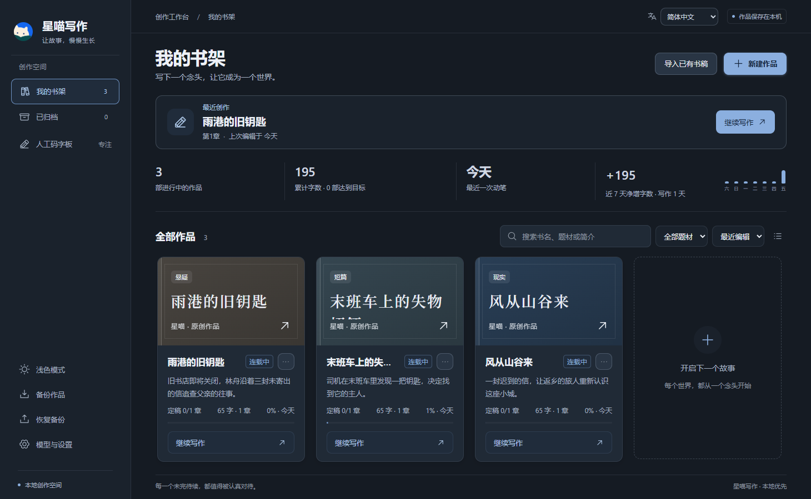
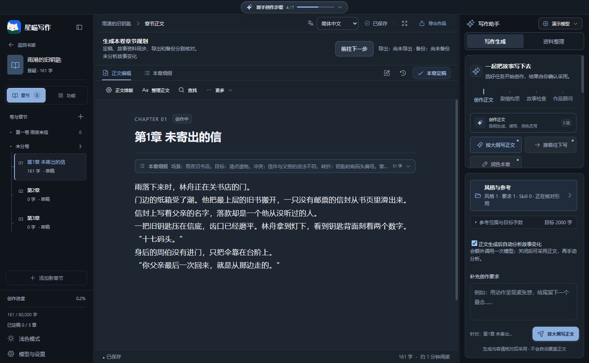
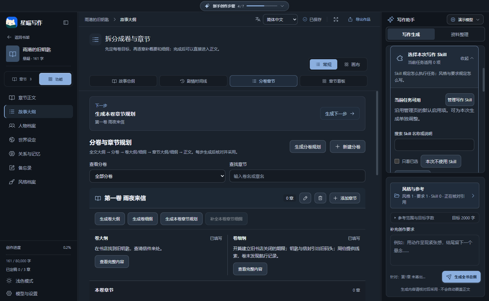
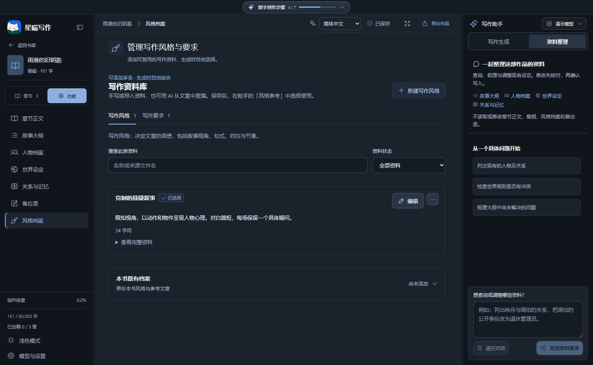
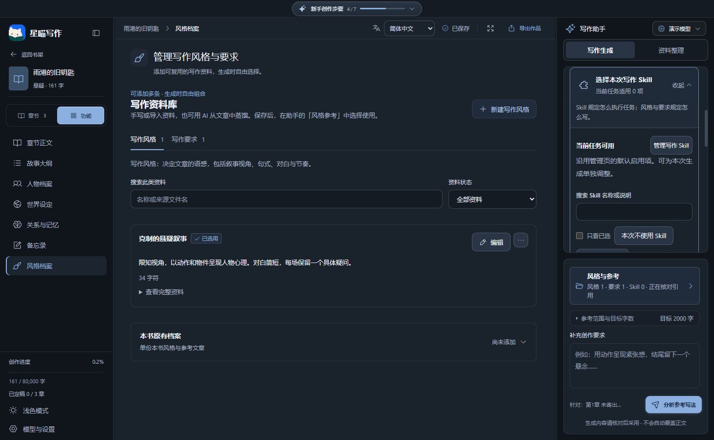
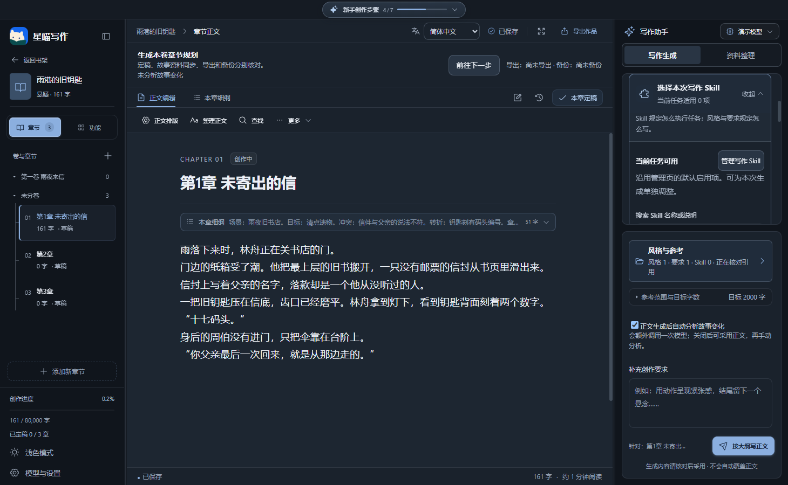
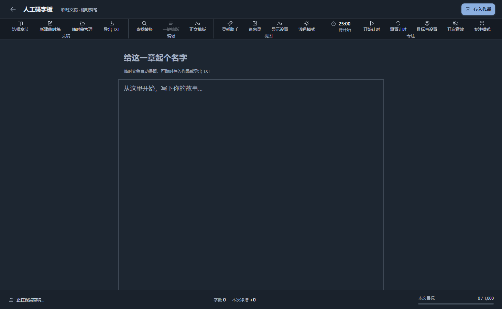
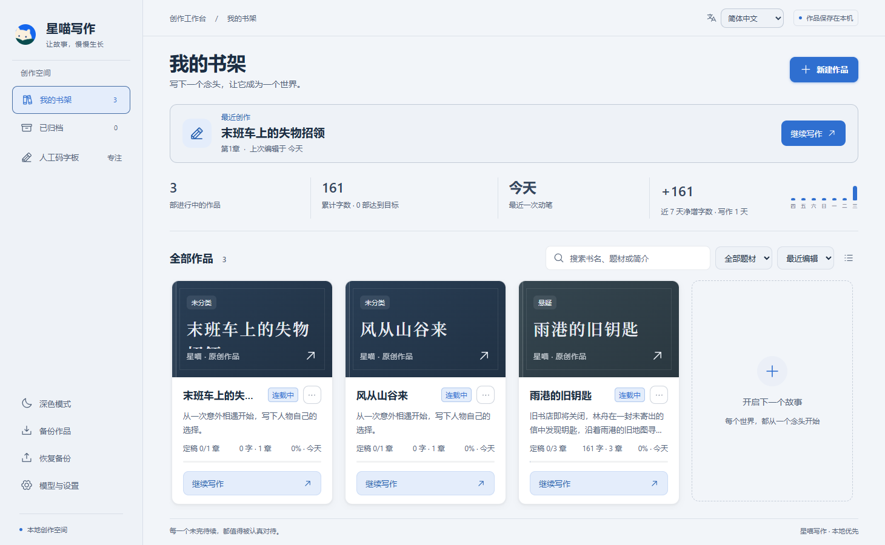
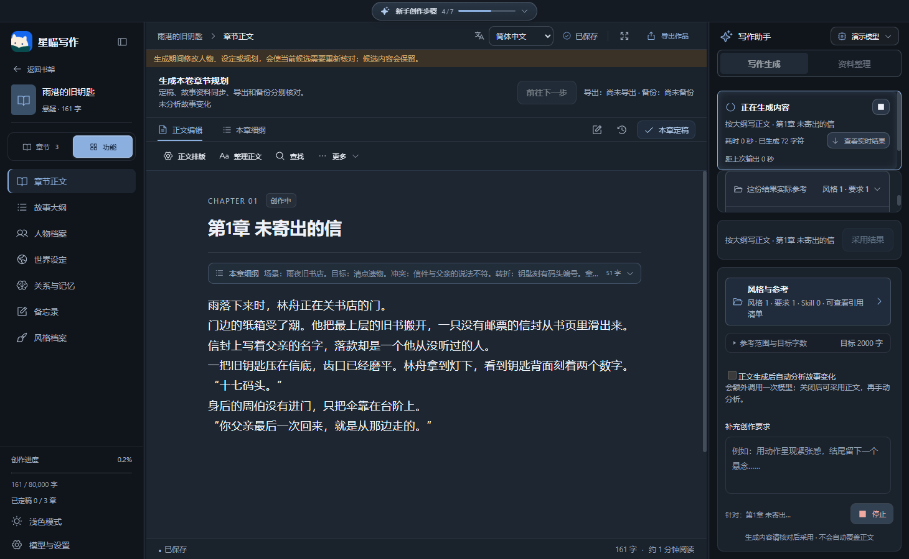
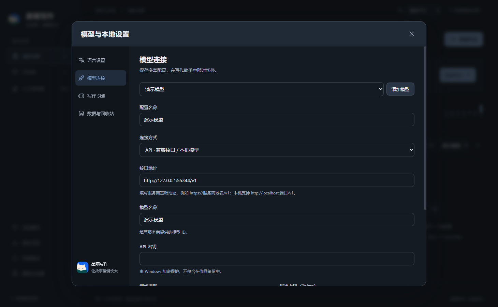

# 星喵写作 · 开源核心版

本地优先的小说工作台，可以手写，也可以接入自己的模型逐步构建故事。

**v0.6.10 · Windows x64 · MIT**

[下载开源安装包](https://github.com/z55902383-debug/xingmiao-writer-core/releases/download/v0.6.10/XingmiaoWriter-Core-0.6.10-x64-Setup.exe) · [完整版](https://github.com/z55902383-debug/xingmiao-writer-releases/releases/tag/v0.6.10) · [English](README.en.md)

**会员免费，无需付费开通。** 完整版区分会员与普通用户，是为了管理创作广场提示词库及相关权限，不是收费套餐。第三方模型和生图费用由服务商决定。开源版不含账号和广场。

## 界面预览

v0.6.10实际界面，以独立演示作品拍摄，不含个人书库、密钥或账号会话。



### 写作与规划





### 资料整理与风格参考







### 人工码字



<details><summary>浅色书架、生成状态与设置</summary>







</details>

## 主要功能

- 短篇由想法、简纲直接拆章；长篇按总纲、分卷、卷纲/细纲、章规划、正文逐步生成与采用，名称与内容同步到对应位置。
- 人工码字板：独立草稿、专注计时、目标统计、查找替换、稿件历史与存入作品。
- 写作助手：写作、续写、润色与检查，实际生成状态、停止入口、候选预览和防覆盖检查。正文变化分析可选，采用后仍可重新分析。
- 资料整理助手：查询与调整人物、世界、关系、时间线、伏笔和规划资料；逐项核对采纳、重新核对、撤销与删除恢复。该助手不读取或修改章节正文、章纲、风格档案和备忘录。
- 风格、要求与Skill：多条资料编辑、导入蒸馏、选择与删除；每次生成单独选择并核对实际引用。14项可编辑内置写法，默认不强制启用。
- 本地书架、归档、分卷章节、人物世界、图谱、时间线、资料画布、备忘录、历史和回收站；中英界面及深浅主题。
- 章节定稿后由作者确认完结，改稿取消完结；TXT/Markdown导出、JSON备份与副本恢复。

## 两种版本

| 功能 | 开源核心版 | 完整版 |
| --- | --- | --- |
| 书架、人工码字、AI写作与短篇/长篇流程 | ✓ | ✓ |
| 资料整理、人物世界、图谱时间线与画布 | ✓ | ✓ |
| 风格要求、Skill、模型配置及导出备份 | ✓ | ✓ |
| 创意工具箱、封面生成、账号与广场 | — | ✓ |
| 内置安装更新 | — | ✓ |

开源版无需星喵账号。两版使用独立书库，跨版本迁移请用JSON备份恢复。完整版附加模块源码不在本仓库。

## 快速开始

用户直接下载安装包，无需Node.js。开发者使用Node.js 24与npm：

```sh
npm ci
npm start
```

开发模式：`npm run dev`。在模型设置配置兼容接口或连接本机Codex，使用费用由服务商决定。

## 检查与构建

```sh
npm test
npm run build
npm run test:onboarding:ui
npm run test:ui
npm run package:win
```

桌面回归使用独立测试书库与模拟模型。默认打包输出位于release目录。

## 数据与使用边界

作品保存在本机，书库位置可在设置中更换。安装目录与书库独立，更新或迁移前请备份。

JSON备份包括最终作品资料、章节及历史、Skill和回收站；**不包含模型密钥、账号会话、资料整理对话及方案撤销历史**。恢复创建副本，旧对话不能用于撤销，但回收资料仍可恢复。

AI请求把本次选中的正文和资料发送到配置的模型服务，输出需作者审核。本地模拟检查不代表真实模型质量或网络可用性。Windows x64安装包未配置代码签名证书。

## 文档与贡献

[功能说明](docs/features.md) · [本次检查](docs/检查记录-v0.6.10.md) · [资料整理](docs/资料整理使用说明.md) · [创作步骤](docs/分步创作流程与采用说明.md) · [上传步骤](docs/GitHub上传步骤.md)

[架构](docs/architecture.md) · [路线图](docs/roadmap.md) · [贡献](CONTRIBUTING.md) · [安全](SECURITY.md) · [更新记录](CHANGELOG.md)

核心源码采用[MIT](LICENSE)，第三方依赖见[许可说明](THIRD_PARTY_NOTICES.md)。核心许可不覆盖完整版附加模块。反馈请提供版本与复现步骤，删除密钥和私人小说内容。
